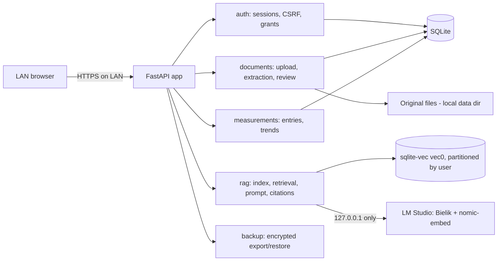

# System Architecture

## Overview
Medyczne Archiwum is a single-process, server-rendered **FastAPI** application running on one home computer. It stores structured data and vectors in one **SQLite** database (with `sqlite-vec`), keeps original files in a local data directory, and talks to a **loopback-only LM Studio** instance for embeddings and answer generation. Browsers on the home LAN are the only clients.

## Architecture Pattern
**Pattern**: Modular monolith organised by domain, with dependency injection.

Each domain package exposes **services** (business rules and access checks) and **routers** (HTTP). Only `main.py` and `web/` compose them into the app. Infrastructure dependencies (DB session, OCR, embedding/chat clients) are injected so tests run without LM Studio or Tesseract. **Access control is enforced in domain services on every endpoint** — hiding UI elements never replaces authorization.

## System Structure

### App core
- **Location**: `src/medical_archive/main.py`, `config.py`, `db.py`
- **Purpose**: `create_app(testing)` mounts static files and includes all routers, exposes `/health`, disables OpenAPI/docs. `config.py` validates settings at startup (session secret ≥ 32 bytes outside testing, data dir, loopback-only LM Studio URL, retrieval thresholds). `db.py` provides `Base`, a cached engine/session factory and the `get_session` dependency.

### auth
- **Location**: `src/medical_archive/auth/`, models in `src/medical_archive/models/`
- **Purpose**: Argon2id passwords, opaque session tokens (only hashes stored), HttpOnly/Secure/SameSite=Strict cookies, CSRF checks, admin bootstrap CLI, one-time invitations, explicit access grants (owner-only sharing, revocation, 404 for hidden resources, no admin bypass).
- **Key Files**: `service.py`, `router.py`, `dependencies.py`, `grants.py`, `grant_router.py`, `passwords.py`, `bootstrap.py`

### documents
- **Location**: `src/medical_archive/documents/`
- **Purpose**: bounded upload (25 MiB, signature/MIME validation), UUID storage keys outside static assets, local text extraction/OCR, metadata suggestions, owner-only approval before archiving and indexing.
- **Key Files**: `service.py`, `router.py`, `storage.py`, `extraction.py`, `review.py`, `metadata.py`, `models.py`

### measurements
- **Location**: `src/medical_archive/measurements/`
- **Purpose**: private manual measurements with validation, history, trends and SVG chart; shareable via grants; usable as assistant sources.
- **Key Files**: `service.py`, `router.py`, `trends.py`, `models.py`

### rag
- **Location**: `src/medical_archive/rag/`
- **Purpose**: deterministic chunking (~500 units, overlap 80), embeddings via LM Studio, user-partitioned vector index, access-gated retrieval, prompt construction, citation validation.
- **Key Files**: `chunking.py`, `embeddings.py`, `index.py`, `retrieval.py`, `prompt.py`, `service.py`, `router.py`, `models.py`

### web
- **Location**: `src/medical_archive/web/`, `templates/`, `static/`
- **Purpose**: HTML pages (login, register/invite, dashboard, documents, review, measurements, chat) rendered with Jinja2 in Polish; `app.css`; trend chart template.

### backup
- **Location**: `src/medical_archive/backup/` (crypto, format, service, maintenance, router, restore CLI); tests in `tests/backup/`
- **Purpose**: encrypted full export/restore of the SQLite DB and original files (plan 4): AES-256-GCM + scrypt envelope, staged validation, journal-based rollback-safe swap, maintenance mode during restore, startup recovery, admin page `/settings/backup` and offline `restore-backup.ps1`.

## Data Flow

**Document import**
1. Owner uploads a PDF/image → size and real format validated → original stored under a UUID key in the data dir.
2. Text extracted from the PDF text layer, otherwise local OCR (Polish).
3. Owner reviews original + recognised text, confirms type and date. Documents remain bound to the uploading account.
4. Only approved documents appear in the archive and are chunked, embedded and written to the owner's (and grantees') vector partition.
5. OCR failure or low confidence is surfaced; the document is never silently indexed.

**Assistant question**
1. Resolve the set of documents/measurements visible to the current user (own + granted).
2. KNN search in `sqlite-vec` **within the user's partition** (filter applied in the query, not after); measurements fetched with a structured query under the same permissions.
3. Prompt built with source IDs; document content treated as untrusted input.
4. Bielik answers via a JSON-schema response format; the app validates cited source IDs and drops unknown ones.
5. Insufficient sources or model failure → explicit "cannot answer" message, never a fabricated answer.

**Sharing**: creating or revoking a grant updates the recipient's index partition, so revoked data is immediately unavailable to RAG.

## External Integrations
- **LM Studio** (OpenAI-compatible API, `127.0.0.1:1234`) — chat (Bielik 1.5B v3.0 Instruct) and embeddings (nomic-embed-text-v1.5, 768 dims). Loopback enforced by config.
- **Tesseract OCR** (`pol`) — local binary.
- **PyMuPDF** — PDF text extraction.
- No other external services, telemetry or CDN.

## Database Schema
- ORM models: `src/medical_archive/models/` (User, Invitation, LoginSession, AccessGrant) and per-domain `models.py` (documents, measurements, rag chunk metadata).
- Migrations: `migrations/versions/` — `0001_identity`, `0002_authentication_sessions`, `0002_documents` (duplicate prefix, linear chain), `0003_document_text`, `0004_vector_index` (`vec0` table, partition key, cosine, 768 dims), `0005_measurements`.

## Configuration
`pydantic-settings` with env prefix `MEDICAL_ARCHIVE_` (e.g. `MEDICAL_ARCHIVE_DATABASE_URL`, session secret, data dir, LM Studio URL/models, retrieval thresholds). Validated at startup; no default secrets in the repository. Alembic `env.py` reads the same database URL.

## Deployment Architecture
Single Windows host, started with `python -m medical_archive` (development, loopback) or `scripts/run-lan.ps1` (production: HTTPS on a private LAN IP, fail-closed settings, preflight gate) after `alembic upgrade head` and admin bootstrap. No containers or CI; `scripts/check-release.ps1` is the local release gate. Encrypted backup/restore and the recovery runbook are documented in the Polish README.

---
*Based on codebase analysis performed 2026-10-14*
