# Kopia zapasowa w Medycznym Archiwum — poradnik dla administratora

*Ostatnia aktualizacja: 15 października 2026 r. Dotyczy wersji aplikacji z funkcją „Kopia zapasowa” (plan 4).*

Ten poradnik jest dla osoby, która w domu opiekuje się Medycznym Archiwum (administratora). Nie musisz znać się na komputerach — wystarczy, że potrafisz zalogować się do aplikacji i zapisać plik na dysku.

## Spis treści

1. [Czym jest kopia zapasowa?](#czym-jest-kopia-zapasowa)
2. [Gdzie znajdziesz kopię zapasową](#gdzie-znajdziesz-kopię-zapasową)
3. [Jak utworzyć kopię zapasową](#jak-utworzyć-kopię-zapasową)
4. [Jak przechowywać plik i hasło kopii](#jak-przechowywać-plik-i-hasło-kopii)
5. [Jak odtworzyć dane z kopii](#jak-odtworzyć-dane-z-kopii)
6. [Komunikaty o błędach i co wtedy zrobić](#komunikaty-o-błędach-i-co-wtedy-zrobić)
7. [Gdy coś pójdzie nie tak w trakcie odtwarzania](#gdy-coś-pójdzie-nie-tak-w-trakcie-odtwarzania)
8. [Dla zaawansowanych: odtwarzanie bez przeglądarki i dostęp z sieci domowej](#dla-zaawansowanych-odtwarzanie-bez-przeglądarki-i-dostęp-z-sieci-domowej)
9. [Najważniejsze wskazówki w skrócie](#najważniejsze-wskazówki-w-skrócie)

---

## Czym jest kopia zapasowa?

Kopia zapasowa to **jeden zaszyfrowany plik** z końcówką `.marchive`, w którym zapisany jest cały stan archiwum. Jeśli komputer się zepsuje, dysk ulegnie awarii albo aktualizacja się nie uda, z tego pliku możesz odzyskać wszystkie dane.

Kopia zawiera dane **wszystkich** domowników, a nie tylko Twoje:

- konta wszystkich użytkowników (adresy e-mail i hasła logowania),
- wszystkie dokumenty (np. wyniki badań, wypisy) wraz z plikami,
- wszystkie pomiary (np. ciśnienie, waga) ze wszystkich profili.

> **Uwaga:** na co dzień administrator nie widzi prywatnych dokumentów innych osób. Plik kopii zawiera jednak **wszystko**. Każdy, kto ma plik kopii i zna hasło kopii, może odczytać dane całej rodziny. Traktuj ten plik jak zaklejoną kopertę z dokumentacją medyczną wszystkich domowników.

**Kiedy robić kopię?**

- przed każdą aktualizacją aplikacji (aplikacja sama o tym przypomina),
- regularnie, np. raz w tygodniu lub po dodaniu ważnych dokumentów.

---

## Gdzie znajdziesz kopię zapasową

Strona kopii zapasowej jest dostępna **tylko dla administratora**. Pozostali domownicy nie widzą tego odnośnika.

1. **Zaloguj się** na swoje konto administratora.
2. W górnym pasku kliknij **Kopia zapasowa** (ostatni odnośnik po prawej, obok „Zaproszenia”).

   

Otworzy się strona **Kopia zapasowa**. Ma dwie części: u góry **Utwórz kopię zapasową**, niżej, w czerwonej ramce, **Odtwórz z kopii zapasowej**.

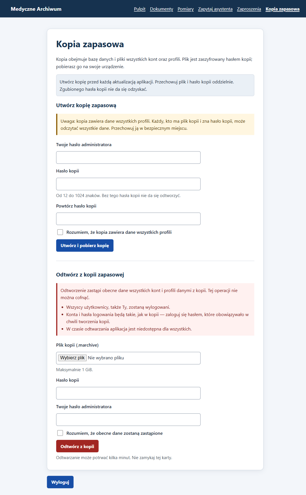

Wskazówka: na górze strony jest stałe przypomnienie: „Utwórz kopię przed każdą aktualizacją aplikacji. Przechowuj plik i hasło kopii oddzielnie. Zgubionego hasła kopii nie da się odzyskać.”

---

## Jak utworzyć kopię zapasową

Utworzenie kopii nic nie zmienia w archiwum — możesz to robić bez obaw, kiedy tylko chcesz.

**Co będzie potrzebne:**

- Twoje hasło administratora (to samo, którym się logujesz),
- nowe **hasło kopii**, które wymyślisz teraz — co najmniej 12 znaków,
- miejsce na pliki, np. pendrive albo dysk zewnętrzny.

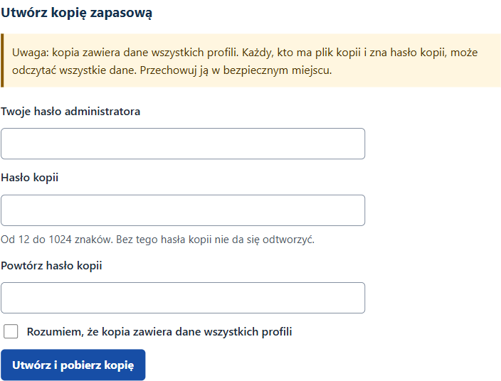

**Kroki:**

1. **Wpisz swoje hasło administratora**

   W polu **Twoje hasło administratora** wpisz hasło, którym logujesz się do aplikacji. Dzięki temu nikt, kto na chwilę dostał się do Twojego zalogowanego komputera, nie zrobi kopii bez Twojej wiedzy.

2. **Wymyśl i wpisz hasło kopii**

   W polu **Hasło kopii** wpisz nowe hasło, którym zostanie zaszyfrowany plik. Zasady:

   - od 12 do 1024 znaków (pod polem widać podpowiedź: „Od 12 do 1024 znaków. Bez tego hasła kopii nie da się odtworzyć.”),
   - **to nie jest hasło logowania** — najlepiej, żeby było inne,
   - dobrym pomysłem jest kilka słów połączonych razem, np. `Wakacje-2026-Sopot-latarnia`.

3. **Powtórz hasło kopii**

   W polu **Powtórz hasło kopii** wpisz to samo hasło jeszcze raz. To chroni przed literówką — gdyby hasło zostało zapisane z błędem, nie dałoby się później odtworzyć kopii.

4. **Zaznacz potwierdzenie**

   Zaznacz pole **Rozumiem, że kopia zawiera dane wszystkich profili**. Bez tego kopia nie zostanie utworzona.

   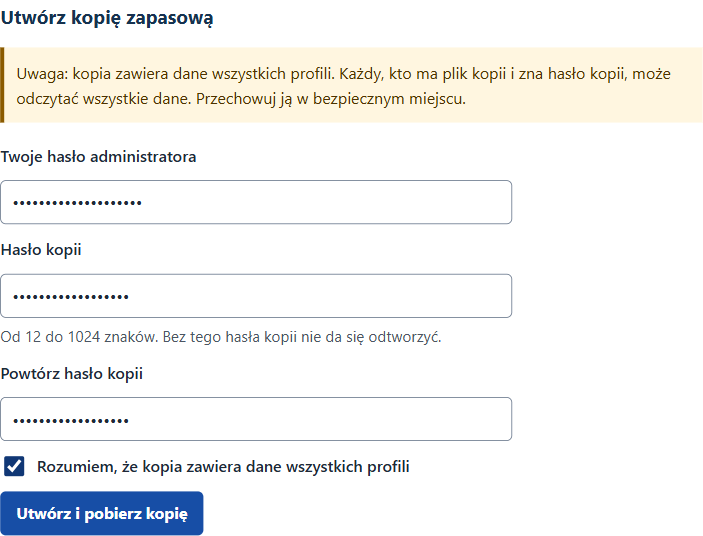

5. **Kliknij „Utwórz i pobierz kopię”**

   Po chwili przeglądarka pobierze plik o nazwie podobnej do `medyczne-archiwum-20261015-080537.marchive`. Liczby w nazwie to data i godzina utworzenia kopii.

   Co powinno się stać: plik pojawi się na liście pobranych plików w przeglądarce (zwykle w folderze **Pobrane**). Strona pozostaje otwarta — nie pojawia się osobny komunikat o sukcesie, dowodem jest pobrany plik.

   Wskazówka: godzina w nazwie pliku jest podana w czasie uniwersalnym (UTC), więc może różnić się od zegarka o 1–2 godziny. To normalne.

6. **Przenieś plik w bezpieczne miejsce** — patrz następny rozdział.

### Co jeśli pojawi się błąd?

Jeśli coś jest nie tak, kopia nie powstanie. Nad formularzem pojawi się czerwony komunikat **„Nie utworzono kopii. Popraw zaznaczone pola.”**, a przy błędnym polu — opis problemu z czerwonym krzyżykiem.

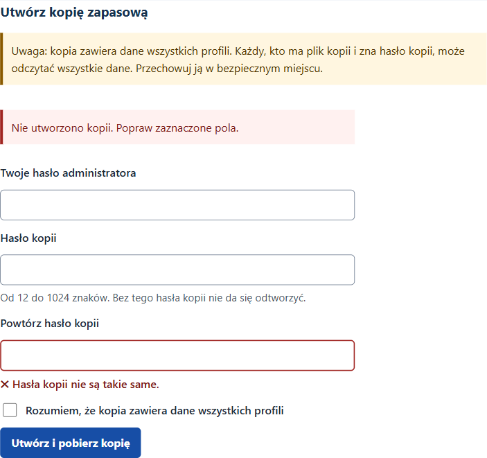

| Komunikat przy polu | Co oznacza | Co zrobić |
|---|---|---|
| „Hasło administratora jest nieprawidłowe.” | Wpisane hasło logowania jest błędne. | Wpisz hasło, którym logujesz się do aplikacji. |
| „Hasło kopii musi mieć od 12 do 1024 znaków.” | Hasło kopii jest za krótkie. | Wymyśl dłuższe hasło (co najmniej 12 znaków). |
| „Hasła kopii nie są takie same.” | W polu powtórzenia jest inne hasło (np. literówka). | Wpisz oba hasła jeszcze raz, uważnie. |
| „Zaznacz potwierdzenie, aby utworzyć kopię.” | Nie zaznaczono pola potwierdzenia. | Zaznacz pole „Rozumiem, że kopia zawiera dane wszystkich profili”. |

Uwaga: po błędzie **wszystkie pola haseł są czyszczone, a potwierdzenie odznaczone**. Trzeba wpisać wszystko od nowa — to celowe, żeby hasła nie zostawały na stronie.

Rzadsze komunikaty:

- **„Nie można utworzyć kopii: dane przekraczają limit 1 GiB.”** — archiwum jest za duże na jeden plik kopii. Skontaktuj się z osobą, która instalowała aplikację.
- **„Operacja kopii zapasowej już trwa.”** — w tej chwili trwa inne tworzenie lub odtwarzanie kopii (np. w drugiej karcie). Poczekaj kilka minut i spróbuj ponownie.
- **„Nie można utworzyć kopii. Szczegóły zapisano w dzienniku aplikacji.”** — wystąpił problem techniczny. Spróbuj ponownie później; jeśli się powtarza, poproś o pomoc osobę, która instalowała aplikację.

---

## Jak przechowywać plik i hasło kopii

To najważniejsza część poradnika.

- **Plik i hasło trzymaj w różnych miejscach.** Na przykład: plik na pendrivie schowanym w szufladzie, a hasło w menedżerze haseł lub zapisane na kartce w innym miejscu. Jeśli ktoś znajdzie tylko plik albo tylko hasło, nie odczyta danych.
- **Nikt nie odzyska zgubionego hasła kopii** — ani aplikacja, ani informatyk, ani twórcy programu. Plik kopii bez hasła jest bezużyteczny. Jeśli zapomnisz hasła, od razu utwórz nową kopię z nowym hasłem i dobrze je zapisz.
- **Nie zostawiaj pliku w folderze Pobrane** na tym samym komputerze. Jeśli komputer się zepsuje, stracisz i archiwum, i kopię.
- Nie wysyłaj pliku e-mailem i nie wrzucaj go do publicznych miejsc w internecie.
- Warto mieć **kilka kopii z różnych dni** — jeśli najnowsza okaże się uszkodzona, sięgniesz po wcześniejszą.
- Zapisz przy haśle kopii również **swoje hasło administratora z dnia tworzenia kopii** (patrz niżej: po odtworzeniu logujesz się hasłami z kopii).

---

## Jak odtworzyć dane z kopii

Odtworzenie przywraca archiwum do stanu z chwili utworzenia kopii.

> **Uwaga:** odtworzenie **zastępuje obecne dane wszystkich kont i profili** danymi z kopii. Wszystko, co dodano po utworzeniu tej kopii (nowe dokumenty, pomiary, konta), zniknie. Tej operacji nie można cofnąć. Jeśli nie masz pewności, najpierw zrób świeżą kopię obecnego stanu.

Przed rozpoczęciem uprzedź domowników: na czas odtwarzania aplikacja będzie dla wszystkich niedostępna, a potem każdy będzie musiał zalogować się ponownie.

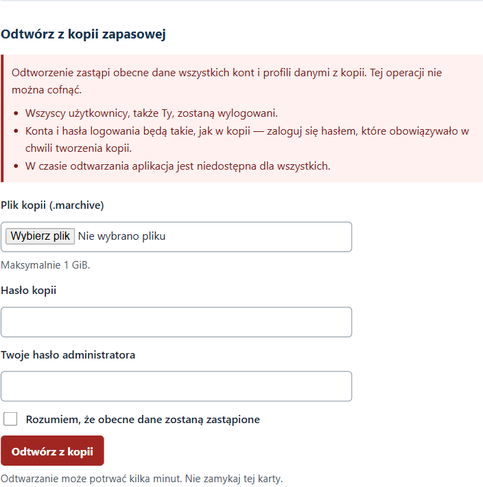

**Co będzie potrzebne:**

- plik kopii `.marchive` (maksymalnie 1 GiB),
- hasło tej kopii,
- Twoje obecne hasło administratora.

**Kroki:**

1. **Wybierz plik kopii**

   W polu **Plik kopii (.marchive)** kliknij **Wybierz plik** i wskaż plik kopii, np. z pendrive’a.

2. **Wpisz hasło kopii**

   W polu **Hasło kopii** wpisz hasło, które ustawiłeś przy tworzeniu tej kopii.

3. **Wpisz swoje hasło administratora**

   W polu **Twoje hasło administratora** wpisz hasło, którym zalogowałeś się teraz.

4. **Zaznacz potwierdzenie**

   Zaznacz pole **Rozumiem, że obecne dane zostaną zastąpione**.

   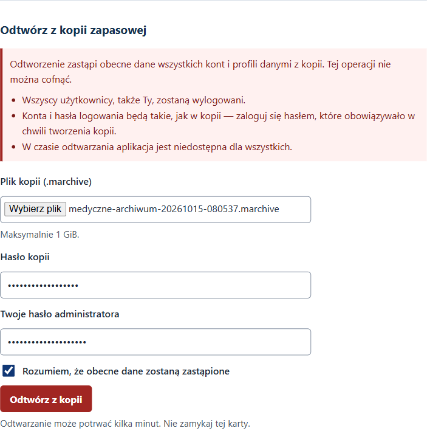

5. **Kliknij czerwony przycisk „Odtwórz z kopii”**

   Odtwarzanie może potrwać kilka minut. **Nie zamykaj karty** przeglądarki i nie wyłączaj komputera.

### Co się dzieje w trakcie

Najpierw aplikacja sprawdza cały plik — czy hasło jest dobre i czy plik nie jest uszkodzony. Dopiero gdy wszystko się zgadza, podmienia dane.

Na czas podmiany aplikacja przechodzi w **tryb konserwacji**. Każdy, kto w tym czasie otworzy archiwum (także na telefonie), zobaczy taką stronę:

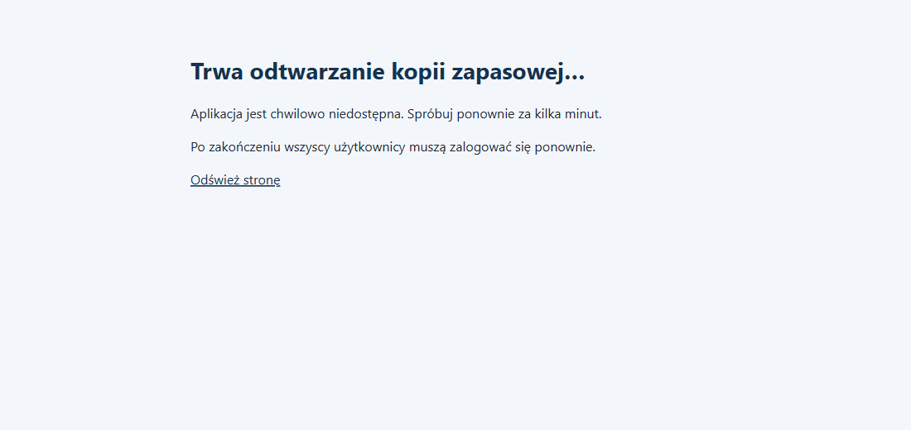

To normalne. Wystarczy chwilę poczekać i kliknąć **Odśwież stronę**.

### Po zakończeniu

- **Wszyscy użytkownicy, także Ty, zostaną wylogowani.**
- Zobaczysz stronę logowania z zielonym komunikatem: **„Kopia została odtworzona. Zaloguj się ponownie. Użyj hasła, które obowiązywało w chwili tworzenia kopii.”**

  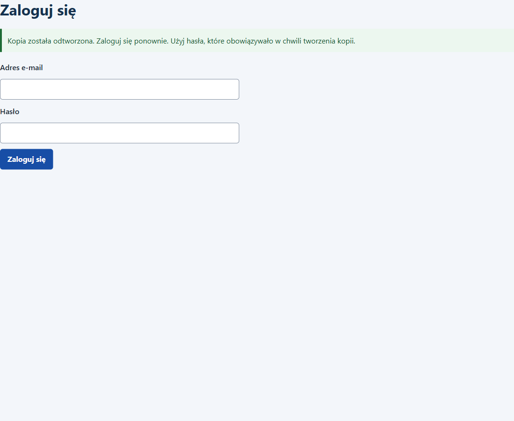

- **Konta i hasła są takie, jak w kopii.** Jeśli ktoś zmienił hasło po utworzeniu kopii, musi zalogować się *starym* hasłem — tym, które obowiązywało w dniu tworzenia kopii. Dotyczy to także Ciebie.

Wskazówka: po zalogowaniu przejrzyj dokumenty i pomiary, żeby upewnić się, że widzisz stan z dnia kopii.

---

## Komunikaty o błędach i co wtedy zrobić

Dobra wiadomość: przy wszystkich poniższych błędach **obecne dane pozostają bez zmian**. Nic nie zostało nadpisane — możesz spokojnie poprawić problem i spróbować ponownie.

Uwaga: po każdym błędzie trzeba ponownie **wybrać plik**, wpisać oba hasła i zaznaczyć potwierdzenie — formularz jest czyszczony.

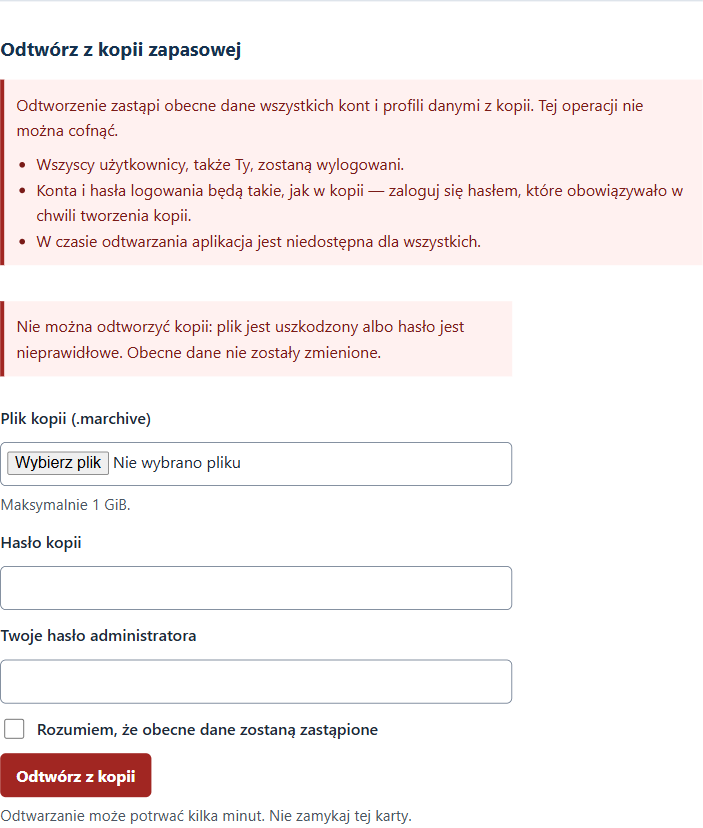

| Komunikat | Co oznacza | Co zrobić |
|---|---|---|
| „Nie można odtworzyć kopii: plik jest uszkodzony albo hasło jest nieprawidłowe. Obecne dane nie zostały zmienione.” | Hasło kopii jest błędne **albo** plik się uszkodził (np. niepełne kopiowanie). Aplikacja celowo nie mówi, który z tych powodów. | Sprawdź hasło (wielkość liter, znaki). Jeśli na pewno jest dobre, użyj innego egzemplarza pliku lub wcześniejszej kopii. |
| „Plik kopii jest za duży (maksymalnie 1 GiB). Obecne dane nie zostały zmienione.” | Wybrany plik przekracza 1 GiB — to zapewne nie jest kopia z tej aplikacji. | Upewnij się, że wybierasz właściwy plik `.marchive`. |
| „Nie można odtworzyć kopii: została utworzona w nowszej lub nieznanej wersji aplikacji. Zaktualizuj aplikację i spróbuj ponownie. Obecne dane nie zostały zmienione.” | Kopia pochodzi z nowszej wersji programu niż ta, której używasz. | Poproś osobę, która instalowała aplikację, o aktualizację, potem spróbuj ponownie. Kopie ze **starszych** wersji działają bez problemu. |
| „Nie można odtworzyć kopii: nie zawiera aktywnego konta administratora. Obecne dane nie zostały zmienione.” | W kopii nie ma żadnego działającego konta administratora — po odtworzeniu nikt nie mógłby zarządzać archiwum. | Użyj innej kopii (np. wcześniejszej). |
| „Operacja kopii zapasowej już trwa.” | W tej chwili trwa inne tworzenie lub odtwarzanie kopii (np. w drugiej karcie lub na innym urządzeniu). | Poczekaj kilka minut i spróbuj ponownie. |
| „Odtwarzanie nie powiodło się i zostało wycofane. Obecne dane nie zostały zmienione.” | Podmiana danych się nie udała, ale aplikacja automatycznie przywróciła poprzedni stan. | Spróbuj ponownie później. Jeśli się powtarza, poproś o pomoc osobę, która instalowała aplikację. |

Gdy błąd dotyczy konkretnego pola, nad formularzem pojawia się ogólny komunikat **„Nie odtworzono kopii. Obecne dane nie zostały zmienione.”**, a przy polu — szczegóły:

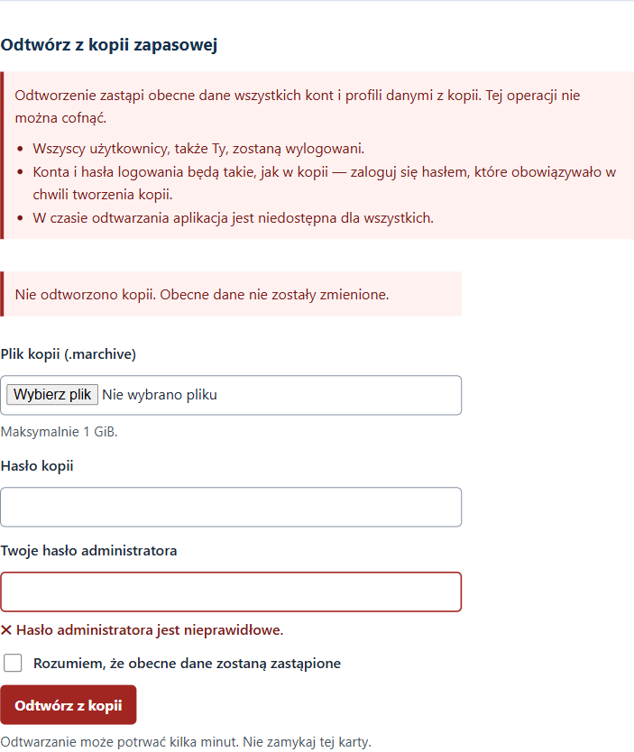

| Komunikat przy polu | Co zrobić |
|---|---|
| „Hasło administratora jest nieprawidłowe.” | Wpisz hasło, którym jesteś teraz zalogowany (nie hasło kopii). |
| „Wybierz plik kopii (.marchive).” | Nie wybrano pliku albo plik jest pusty — wybierz właściwy plik. |
| „Zaznacz potwierdzenie, aby odtworzyć kopię.” | Zaznacz pole „Rozumiem, że obecne dane zostaną zastąpione”. |

---

## Gdy coś pójdzie nie tak w trakcie odtwarzania

Aplikacja jest zbudowana tak, żeby awaria w trakcie odtwarzania nie zniszczyła danych. Przed podmianą odkłada na bok obecne dane i — jeśli podmiana się nie powiedzie — **automatycznie je przywraca**. Zwykle zobaczysz wtedy komunikat „Odtwarzanie nie powiodło się i zostało wycofane. Obecne dane nie zostały zmienione.”

W bardzo rzadkim przypadku nawet to automatyczne przywracanie nie zdąży się zakończyć. Zobaczysz wtedy stronę:

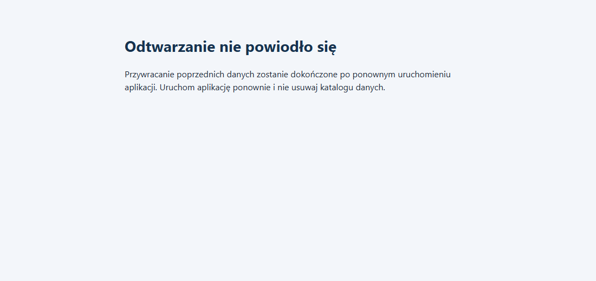

**Co zrobić:**

1. **Uruchom aplikację ponownie** (zamknij okno, w którym działa serwer, lub naciśnij w nim Ctrl+C, a potem uruchom aplikację tak jak zwykle). Jeśli nie wiesz, jak to zrobić, po prostu uruchom ponownie komputer.
2. **Nie usuwaj ani nie przenoś niczego z katalogu danych aplikacji.** Tam leżą odłożone poprzednie dane.
3. Przy starcie aplikacja sama dokończy przywracanie — **dane sprzed próby odtworzenia wrócą automatycznie**.
4. Zaloguj się i sprawdź, czy wszystko jest na miejscu. Jeśli aplikacja nie chce się uruchomić, nie zmieniaj niczego w katalogu danych i skontaktuj się z osobą, która instalowała aplikację.

To samo dotyczy przerwy w zasilaniu w trakcie odtwarzania: po ponownym uruchomieniu aplikacja sama posprząta albo wycofa niedokończone zmiany.

---

## Dla zaawansowanych: odtwarzanie bez przeglądarki i dostęp z sieci domowej

Te czynności wykonuje zwykle osoba, która instalowała aplikację. Dokładne instrukcje są w pliku **README** w katalogu aplikacji:

- **Odtwarzanie offline** (gdy strona w przeglądarce nie działa) — README, sekcja „8. Odtwarzanie offline (CLI)”, polecenie `.\scripts\restore-backup.ps1`. Ważne:
  - **przed odtwarzaniem offline zatrzymaj serwer** — polecenie samo tego nie sprawdza, a odtwarzanie przy działającym serwerze podmieni dane pod pracującą aplikacją;
  - **na nowym komputerze** (pusty katalog danych) najpierw wykonaj `python -m alembic upgrade head`, a dopiero potem odtwarzaj kopię — bez tego odtwarzanie zostanie przerwane.
- **Dostęp z telefonu i innych komputerów w domu przez bezpieczne połączenie (HTTPS)** — README, sekcje „2. Uruchomienie w sieci LAN (HTTPS)” (certyfikaty i `.\scripts\run-lan.ps1`), „3. Zapora Windows” oraz „11. Kontrola izolacji sieci”.
- **Próbne odtworzenie kopii** na osobnym katalogu testowym — README, sekcja „9. Weryfikacja kopii”. Warto to zrobić przynajmniej raz, zanim zaczniesz polegać na kopiach.
- **Zgubione hasło administratora** — README, sekcja „10. Utrata hasła kopii lub hasła administratora”.

---

## Najważniejsze wskazówki w skrócie

- Rób kopię **przed każdą aktualizacją** i regularnie.
- Kopia zawiera **dane wszystkich domowników** — chroń ją jak dokumentację medyczną.
- Hasło kopii: **co najmniej 12 znaków**, wpisane dwa razy, **inne niż hasło logowania**.
- **Plik i hasło przechowuj oddzielnie.** Zgubionego hasła kopii **nikt nie odzyska**.
- Odtworzenie **zastępuje** obecne dane i **wylogowuje wszystkich**; logujesz się potem hasłami z dnia kopii.
- Przy błędach odtwarzania **obecne dane pozostają bez zmian**.
- Strona „Odtwarzanie nie powiodło się” = **uruchom aplikację ponownie** i nie ruszaj katalogu danych; poprzednie dane wrócą same.
