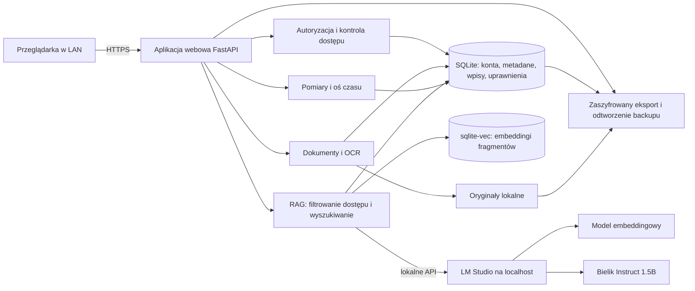

# Medyczne Archiwum — projekt rozwiązania

**Status:** projekt zatwierdzony do przeglądu specyfikacji
**Data:** 2026-10-13

## Cel

Prywatna, lokalna aplikacja dla domowników do porządkowania dokumentacji medycznej, recept i ręcznych pomiarów. Umożliwia wyszukiwanie informacji z własnych materiałów przez lokalny RAG z modelem Bielik 1.5B v3.0 Instruct uruchomionym w LM Studio.

Aplikacja ma pomagać odnaleźć i zrozumieć treść własnych zapisów, a nie diagnozować, zalecać leczenie ani zastępować konsultacji medycznej.

## Użytkownicy i granice dostępu

- Aplikacja działa na jednym domowym komputerze i jest dostępna dla urządzeń w lokalnej sieci (LAN). Nie jest wystawiana do Internetu.
- Każdy domownik ma odrębne konto oraz prywatny zbiór danych. Sam fakt bycia administratorem aplikacji nie daje dostępu do dokumentów ani pomiarów innych osób.
- Początkowa konfiguracja tworzy administratora. Administrator może wystawiać jednorazowe zaproszenia do utworzenia kont, ale nie odczytuje danych medycznych.
- Właściciel danych może jawnie udostępnić wskazane materiały innemu kontu i cofnąć dostęp. Bez udostępnienia dane pozostają prywatne.
- Hasła są przechowywane jako bezpieczne skróty, a sesje przeglądarki używają bezpiecznych ciasteczek. Ruch do aplikacji z urządzeń LAN jest chroniony przez HTTPS.
- LM Studio nasłuchuje tylko na komputerze hostującym; aplikacja jest jedynym komponentem pośredniczącym w dostępie do modeli.

## Zakres pierwszej wersji

1. Niezależne konta, logowanie, jednorazowe zaproszenia oraz jawne udostępnianie i cofanie dostępu do danych.
2. Import PDF-ów, zdjęć i skanów, w tym recept, które w MVP są archiwizowane i przeszukiwane jako dokumenty. Użytkownik może dodać własny wpis tekstowy.
3. Odczyt tekstu z PDF lub lokalny OCR zdjęć/skanów, z podglądem oryginału i wyniku rozpoznawania.
4. Ręczne potwierdzanie profilu, typu i daty dokumentu przed zapisaniem go w archiwum i indeksie wyszukiwania.
5. Archiwum dokumentów z filtrami oraz osią czasu.
6. Ręczne wpisy pomiarów: nazwa, wartość, jednostka, data/godzina i opcjonalna notatka; tabela i prosty wykres historii.
7. Pytania do asystenta o dokumenty i pomiary, odpowiedzi z cytowaniami źródeł.
8. Ręczny eksport szyfrowanej kopii zapasowej i jej odtworzenie.

Poza zakresem: diagnozowanie, zalecenia terapeutyczne, przypomnienia o lekach i zarządzanie dawkowaniem; integracje z systemami placówek lub aptek; synchronizacja z chmurą; automatyczne odczytywanie urządzeń pomiarowych; dostęp przez publiczny Internet.

## Doświadczenie użytkownika

Ekran główny to pulpit pacjenta z:

- przełącznikiem aktywnego, dostępnego archiwum;
- ostatnio dodanymi dokumentami i szybką akcją dodania pliku;
- skrótem ostatnich pomiarów i prostym trendem;
- polem do zadania pytania asystentowi.

Nawigacja prowadzi do archiwum dokumentów (z kategorią recept), osi czasu, pomiarów i asystenta. W widoku odpowiedzi źródło otwiera odpowiedni dokument i stronę albo konkretny wpis pomiaru.

### Przepływ importu

1. Użytkownik przesyła PDF lub obraz do aplikacji.
2. Aplikacja sprawdza rzeczywisty format i konfigurowalny limit rozmiaru pliku, zapisuje oryginał poza katalogiem publicznych zasobów i rozpoczyna ekstrakcję tekstu. Dla skanów używa lokalnego OCR z obsługą języka polskiego.
3. Użytkownik widzi oryginał, rozpoznany tekst oraz sugerowane metadane: osobę/archiwum, typ i datę.
4. Użytkownik poprawia lub zatwierdza metadane. Dopiero zatwierdzony dokument staje się widoczny w archiwum i jest indeksowany.
5. Awaria lub niska pewność OCR jest widoczna; dokument nie jest po cichu traktowany jako poprawnie rozpoznany ani indeksowany bez potwierdzenia.

## Architektura logiczna

### Technologie i komponenty

- Backend: Python z FastAPI.
- Interfejs: responsywna aplikacja webowa renderowana po stronie serwera (Jinja2) z lekką interaktywnością; wykres pomiarów w komponencie JavaScript.
- Dane strukturalne i metadane: lokalny SQLite.
- Wektory: rozszerzenie `sqlite-vec` w tej samej bazie, aby uniknąć osobnego serwera wyszukiwania.
- Pliki: oryginały przechowywane lokalnie w katalogu danych aplikacji, poza samymi rekordami SQLite.
- Ekstrakcja: najpierw tekstowa warstwa PDF, a w razie jej braku lokalny OCR dla obrazów/PDF-ów, z polskim pakietem językowym.
- LLM i embeddingi: LM Studio przez lokalny interfejs zgodny z API OpenAI. Bielik generuje odpowiedzi; osobny, wielojęzyczny model embeddingowy obsługuje wektory. Model embeddingowy należy dobrać i zweryfikować na polskich zapytaniach oraz krótkich dokumentach przed wdrożeniem.
- Brak telemetrii i zewnętrznych API w przepływie danych aplikacji. Treść dokumentów, fragmenty, embeddingi i pytania nie opuszczają komputera hostującego.

## Dane i izolacja

Podstawowe rekordy obejmują:

- konto użytkownika i jego rolę administracyjną;
- zaproszenie jednorazowe z terminem ważności i stanem wykorzystania;
- dokument z właścicielem, ścieżką pliku, typem, datą, stanem OCR i metadanymi;
- fragment dokumentu z numerem strony, tekstem i embeddingiem;
- pomiar z właścicielem, nazwą, wartością, jednostką, czasem i opcjonalną notatką;
- jawne uprawnienie udostępniające wskazane dane innemu użytkownikowi.

Każde zapytanie do dokumentów, pomiarów i RAG jest ograniczane do danych aktualnie zalogowanego użytkownika i jawnie udostępnionych mu rekordów. Dla RAG aplikacja najpierw ustala zbiór dozwolonych dokumentów i dopiero w nim wyszukuje podobne fragmenty; pomiary pobiera zapytaniem strukturalnym ograniczonym do tego samego zbioru uprawnień. Filtr dostępu musi być zastosowany przed użyciem jakiegokolwiek rekordu jako kontekstu dla modelu. Usunięcie lub zmiana uprawnienia od razu unieważnia możliwość pobierania tych danych przez RAG.

## Kontrakt asystenta AI

- Odpowiada wyłącznie na podstawie kontekstu odnalezionego w dokumentach i pomiarach dostępnych danemu użytkownikowi.
- Każde twierdzenie oparte na archiwum zawiera cytowanie: nazwę dokumentu i numer strony albo identyfikowalny wpis pomiaru. Cytowania są budowane i walidowane przez aplikację na podstawie identyfikatorów źródeł przekazanych modelowi; niepoprawne lub nieznane identyfikatory nie są pokazywane jako źródła. Cytowanie jest klikalne.
- Gdy źródeł brak, są nieczytelne albo nie wspierają odpowiedzi, asystent mówi wprost, że nie może odpowiedzieć na podstawie dostępnych danych. Nie uzupełnia luk wiedzą domyślną.
- Nie diagnozuje, nie ocenia pilności objawów, nie zaleca leczenia ani zmian leków.
- Treść dokumentów jest niezaufanym wejściem: nie może nadawać modelowi instrukcji ani przyznawać mu dostępu do narzędzi lub danych spoza kontekstu.
- Niedostępny model lub błąd generowania zwraca czytelny komunikat o braku odpowiedzi; nie tworzy odpowiedzi zastępczej wyglądającej na poprawną.

## Bezpieczeństwo, backup i awarie

- Serwis jest osiągalny tylko w LAN; LM Studio pozostaje dostępne wyłącznie lokalnie.
- HTTPS chroni połączenie z aplikacją w sieci domowej. Każdy endpoint sprawdza tożsamość i uprawnienia niezależnie od ograniczeń interfejsu.
- Pliki są przechowywane poza statycznymi zasobami webowymi i udostępniane wyłącznie przez endpoint sprawdzający uprawnienia. Logi aplikacji nie zapisują treści dokumentów, pomiarów ani pytań.
- Komputer hostujący powinien mieć włączone szyfrowanie dysku (np. BitLocker) oraz aktualizacje systemu.
- Ręczny backup obejmuje SQLite i oryginalne pliki w jednym zaszyfrowanym archiwum. Szyfrowanie używa uwierzytelnionego szyfru AES-256-GCM i hasła przetworzonego przez scrypt; format zawiera wersję, sól i nonce potrzebne do odtworzenia. Odtworzenie weryfikuje integralność przed zastąpieniem danych.
- Oryginał dokumentu pozostaje dostępny nawet przy awarii ekstrakcji OCR, embeddingów lub LM Studio. Status przetwarzania można ponowić, a błędy są jawne.
- Zmiany metadanych, indeksu i praw dostępu są transakcyjne lub mają bezpieczną kolejność, by błąd nie pozostawiał pozornie poprawnego, częściowo zapisanego dokumentu.

## Kryteria akceptacji

1. Konto bez uprawnienia nie może odczytać ani wyszukać cudzych dokumentów lub pomiarów przez UI, API ani RAG.
2. Niepotwierdzony import nie pojawia się w archiwum ani wynikach wyszukiwania.
3. Cytowanie w odpowiedzi otwiera właściwy dokument i stronę albo wskazany pomiar.
4. Przy braku wystarczających źródeł, niskiej jakości OCR lub niedostępnym LM Studio aplikacja zgłasza ograniczenie i nie fabrykuje odpowiedzi.
5. Pomiary można dodać, poprawić, wyświetlić chronologicznie i na wykresie oraz znaleźć w odpowiedzi z cytowaniem wpisu.
6. Zaszyfrowany backup można odtworzyć do zgodnego stanu; błędne hasło lub uszkodzenie jest wykrywane bez nadpisywania istniejących danych.
7. Dane nie są wysyłane do usług zewnętrznych, a usługa modelu nie jest dostępna bezpośrednio z innych urządzeń LAN.

## Weryfikacja

- Testy integracyjne bazy i warstwy dostępu obejmują brak przecieków między kontami, jawne udostępnienie i jego cofnięcie.
- Testy przepływu dokumentu sprawdzają upload, zatwierdzenie, stronę źródłową, reindeksowanie oraz zachowanie przy błędzie OCR.
- Testy asystenta używają kontrolowanego lokalnego serwera modelu lub atrap i sprawdzają cytowania, odpowiedź „brak danych”, filtry właściciela i brak odpowiedzi przy awarii modelu.
- Testy backupu sprawdzają poprawne odtworzenie, błędne hasło, uszkodzony plik i brak destrukcyjnego nadpisania.
- Test ręczny na docelowym komputerze potwierdza jakość polskiego OCR, trafność wyszukiwania na nieidentyfikujących, przykładowych dokumentach oraz czas odpowiedzi Bielika 1.5B.

## Założenia do sprawdzenia przed implementacją

- Komputer hostujący jest tym samym urządzeniem, na którym działa LM Studio, ma wystarczające zasoby na OCR, embeddingi i Bielika oraz może udostępniać aplikację w LAN.
- Model embeddingowy jest oddzielny od Bielika i dostępny lokalnie przez LM Studio.
- Zależność `sqlite-vec` jest dostępna dla wybranej wersji Pythona i platformy; implementacja ma uruchamiać kontrolę dostępności rozszerzenia przy starcie i zgłaszać błąd konfiguracji bez pozornego fallbacku.
- Konfiguracja HTTPS i zaufanie certyfikatu na urządzeniach LAN zostaną opisane dla wybranego sposobu uruchomienia, zanim aplikacja będzie używana z prawdziwymi danymi.
